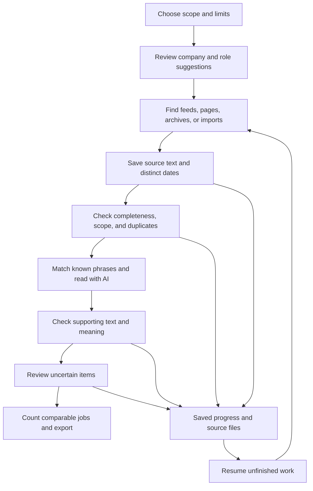

# Degent: plan for technical skills, people skills, work habits, and AI use

Prepared October 7, 2026, America/Chicago. This is a planning document. It preserves the original product idea and proposes additions; it does not implement them. Existing application files, configuration, research notes, and saved runs are unchanged.

**1. The product and the recommended combination**

Degent should answer: “What do employers ask people in comparable jobs to know, do, and take responsibility for—and how has that wording changed over time?”

Keep every part of the original brief: user-selected companies and related roles; company and role suggestions; seniority, geography, and time filters; current and historical descriptions; visible progress; usage limits; stop/resume; evidence review; comparisons; and exports. Add people skills, work habits, and practical AI use alongside the existing technical and domain requirements.

The recommended combination is:

| Need | Recommended approach | Reason |
|---|---|---|
| Run the research | Reuse the existing local application and its fixed sequence of stages | Most of the basic machinery already exists |
| Find current postings | Official career pages and public job feeds, with bounded search | Usually the clearest original source |
| Recover past wording | Targeted Wayback and Common Crawl retrieval; dated user imports when available | A current page cannot establish what a posting said years ago |
| Read difficult live pages | Optional Firecrawl fallback using existing credits | Useful for discovery and page reading; does not recover deleted material by itself |
| Identify requirements | Simple matching plus one AI reading of each complete description | Matching finds known terms; AI interprets context and unfamiliar wording |
| Handle uncertainty | Exact supporting text, limited second-model review, then human decisions | A plausible label is insufficient evidence |
| Compare and export | Deterministic counting over reviewed, comparable groups | Counts should be reproducible without asking a model to calculate them |
| Use model access | Keep the existing ChatGPT-authenticated Codex route for the local pilot | Already integrated; separately validate actual model access and output quality |

Use a fixed workflow with a few bounded AI tasks. Company suggestions, role suggestions, and ambiguous wording benefit from AI. Downloading, date checks, duplicate detection, saved progress, budgets, and percentages should be ordinary code. There is no present evidence that multiple autonomous agents, a new framework, or a different application stack would solve the main problem.

**2. What the repository actually has**

The following are findings from reading the implementation, not claims that a new end-to-end test passed:

| Existing area | What is present | What the plan adds or validates |
|---|---|---|
| [Archive retrieval](/Users/veerr_89/Work/agents/degent/degent/archive.py) and [run stages](/Users/veerr_89/Work/agents/degent/degent/cli.py) | Wayback/Common Crawl lookup, bounded body retrieval, saved run records, source hashes | Targeted retrieval experiments and clearer separation of retrieval, parsing, and eligibility failures |
| [Requirement extraction](/Users/veerr_89/Work/agents/degent/degent/extract.py) | A small technical phrase list, communication matching, optional Codex extraction, exact-quote checks, versioned cache keys | Broader vocabulary, context-aware work habits, AI-use categories, and meaning checks |
| [Requirement format](/Users/veerr_89/Work/agents/degent/schemas/requirement.schema.json) | Original wording, evidence, concept, required/preferred/unclear, negation, experience, alternatives | Explicit “not required”; separate responsibility and company-language labels; unknown vocabulary review |
| [Comparisons](/Users/veerr_89/Work/agents/degent/degent/compare.py) | Distinct-vacancy counts, period comparisons, saved-version differences, small-sample suppression | Separate required/preferred views, combinations of skills, wording-versus-meaning comparisons, consistent-period checks |
| [Dashboard](/Users/veerr_89/Work/agents/degent/degent/dashboard.py), [frontend](/Users/veerr_89/Work/agents/degent/degent/web/app.js), and [review storage](/Users/veerr_89/Work/agents/degent/degent/review.py) | Local interface, worker control, review decisions and report generation | Plain-language requirement filters and review reasons |

The original brief describes a broad configurable product. The current implementation is narrower: six discovery employers; US roles; entry/mid-level work; and separate fraud analytics/strategy, credit-risk analytics, and quantitative credit/risk/capital modeling tracks. Retain those as the pilot scope. Broader levels, geographies, and interactive similarity suggestions remain part of the product plan, not functionality already demonstrated.

The saved [historical report](/Users/veerr_89/Work/agents/degent/runs/fintech-historical-2026-10-07/report.json) records **150 body attempts, 47 failed attempts, 103 rejected attempts, and zero complete eligible observations**. Reasons include invalid archive records, HTTP errors, incomplete descriptions, and role exclusions. Those categories do not prove that every excluded page was correctly classified. Audit the rejected material before treating zero accepted results as an archive-coverage finding.

The first decision is therefore whether this source-and-filter combination can recover useful evidence. Expanding the vocabulary alone will not create a historical dataset.

**3. What to recognize beyond technical skills**

Use “People skills and work habits” in the interface. These phrases describe employer expectations; the app is not measuring an applicant's personality or ability.

The table is a proposed recognition guide. Phrases in the same row are related candidates, not unconditional synonyms. Each label needs support in the surrounding sentence.

| Plain-language label | Wording to look for | Interpretation rule |
|---|---|---|
| Initiative | high agency, proactive, self-starter, takes initiative, bias for action | Acts on problems without waiting for every instruction; do not infer all other work habits |
| Ownership and follow-through | owns outcomes, accountable, end-to-end ownership, follows through | Takes responsibility for completing work; ownership of company shares is unrelated |
| Independent work | self-directed, works independently, minimal supervision, autonomous | Concerns the person; autonomous AI agents are a different subject |
| Handling unclear problems | comfortable with ambiguity, creates structure, no established playbook | Can work when the path is incomplete; a fast-paced workplace alone is insufficient |
| Resourcefulness | unblocks work, finds a way, resourceful, creative problem solving | Looks for practical ways around obstacles; preserve vague slogans without overinterpreting them |
| Communication | clear writing, presents findings, explains complex ideas, data storytelling | Keep writing, speaking, and explaining analysis as separate details |
| Working across teams | cross-functional collaboration, partners with product, business partnering | Record the named teams or audiences |
| Helping others make decisions | stakeholder management, influence without authority, aligns priorities | Explain as gaining agreement and helping people act; do not infer people management |
| Judgment | sound judgment, business acumen, commercial awareness, balances tradeoffs | Record the decision context, such as risk versus growth |
| Customer understanding | customer empathy, user-focused, understands customer needs | Preserve whether the audience is an internal team or an external customer |
| Learning and adaptability | curiosity, learns quickly, learning agility, adaptable, growth mindset | Learning new tools differs from accepting organizational change |
| Planning and priorities | prioritization, manages competing demands, project delivery | Record expected planning or delivery responsibility |
| Care and reliability | attention to detail, dependable, quality-focused, thorough | Connect to stated work; do not automatically infer compliance expertise |
| Leadership and support | mentoring, coaching, develops others, leads projects | Separate project leadership, mentorship, and direct management |
| Persistence | perseverance, resilience, works through setbacks | Do not convert this into a requirement to tolerate unhealthy working conditions |

O*NET provides a useful reference vocabulary for initiative, adaptability, curiosity, cooperation, and other work styles. Use it to organize concepts and retain attribution, while allowing employer language that does not map neatly to its categories. Its occupation descriptions are not evidence that a particular employer requested a skill. [O*NET Work Styles](https://www.onetonline.org/find/descriptor/browse/1.D).

**4. Recognize practical AI use separately from AI engineering**

An employer may want someone who uses AI effectively without wanting someone who trains or deploys models. Record the tool, the work it supports, and the action expected.

| Label | Candidate wording | What must be established from the posting |
|---|---|---|
| AI familiarity | AI literacy, AI fluency, comfortable with AI tools | Whether it means awareness, actual experience, or an undefined preference |
| Using AI in everyday work | AI-assisted analysis, uses AI assistants, AI-enabled productivity | The task: research, writing, SQL, coding, reporting, presentations, or something else |
| Giving useful instructions to AI | prompting, prompt design, provides context, reusable prompts | Whether this is ordinary tool use or a technical specialization |
| Improving workflows with AI | automates repetitive work, builds AI workflows, AI-first workflows | The work being changed and any expected outcome |
| Working with AI agents | agentic workflows, AI agents, orchestration, human-in-the-loop | Whether the person uses, configures, builds, supervises, or evaluates the system |
| Checking AI output | validates generated analysis, fact-checks, evaluates outputs | Expected checks and responsibility for the result |
| Careful use of AI | responsible AI, confidentiality, data privacy, governance | The actual practice requested; do not infer certification or legal expertise |
| Helping a team adopt AI | AI enablement, trains colleagues, documents best practices | Teaching, process improvement, or organizational change |
| Connecting or building AI systems | model integration, APIs, retrieval systems, evaluations, fine-tuning | Keep in technical skills; also link to a workflow when explicitly described |

Record named tools separately from these concepts: ChatGPT, Claude, Copilot, Cursor, Codex, Gemini, Zapier, Make, n8n, and any others actually stated. This is a starter watchlist, not a claim that all occur in the pilot sample. Preserve ambiguity: “Copilot” without context may not identify a specific product. A tool name alone does not establish advanced ability. “AI-native” without an action should remain vague wording.

Also distinguish the employee's AI use from the employer's product and recruitment process. A description of an AI company, or a notice that applications are screened with AI, is not an applicant skill requirement.

**5. Real wording found during this research**

These are current-page examples checked for this plan. They illustrate vocabulary and context only. They do not establish when the wording first appeared, market prevalence, or changes since 2023. Several are outside the pilot's geography, role, or seniority and must not enter its comparison sample.

| Employer and role | Observed wording or practice | Design implication |
|---|---|---|
| Sphere — AI Agent Infrastructure Lead | “High agency,” explained through taking an unclear problem to a usable result | Preserve the employer's explanation; this is stronger evidence than a standalone buzzword. [Posting](https://jobs.ashbyhq.com/sphere/9e1defbe-b135-4117-90b0-06548fa75fa7) |
| Coreflow — Growth Generalist | “High agency, high ownership” appears under how the company works; AI use appears in example projects | Company-wide expectations and job responsibilities need separate labels. [Posting](https://jobs.ashbyhq.com/coreflow/ff8662fe-3d20-4367-a731-dfceddc24540) |
| Ramp — Applied AI Engineer, Fullstack | Agency appears in company hiring language; practical use of coding models and workflows appears in role requirements | Keep the location and scope of each statement. [Posting](https://jobs.ashbyhq.com/ramp/6a7e382f-240a-4952-b9e5-7fe2b3856bc9) |
| Emergent — AI Analyst | “Strong async communication skills,” everyday AI assistance, and analysis automation | Recognize written collaboration alongside practical AI use. [Posting](https://job-boards.greenhouse.io/emergentlabsinc/jobs/4088471009) |
| Smartly — Senior Business Analytics Analyst | Recurring AI-assisted reporting, human checks, and team adoption; a separate recruiting notice also mentions AI | Extract work expectations and exclude the recruitment notice from skill counts. [Posting](https://job-boards.greenhouse.io/smartlyio/jobs/6126663004) |

**6. The rules that prevent misleading labels**

Save three independent judgments for each statement:

- **Where it applies:** applicant qualification, job responsibility, company-wide expectation, company/product description, hiring-process notice, or unclear.
- **How strongly it is asked for:** required, preferred, explicitly not required, or unclear. A responsibility can remain a responsibility without being forced into “required qualification.”
- **How it was matched:** exact phrase, reviewed equivalent meaning, or unresolved wording.

“Not stated” is a document-level result for a concept after processing a complete description; it is not an invented quotation. A missing page, incomplete text, failed extraction, or unchecked concept is unknown, not “not stated.” Preserve explicit prohibitions separately where necessary: “must not upload customer records” is not the same as “AI experience is not required.”

Examples of safeguards:

- “High agency” can be associated with initiative while preserving its original wording. Add independence, ownership, or persistence only when separately supported.
- “Experience with AI is a bonus” is preferred; “we use AI to review applications” is hiring-process information.
- “Comfortable with ambiguity” is not a statement about years of experience.
- “Partner with engineering” is not evidence that the employee must be an engineer.
- “Own the credit policy analysis” is a responsibility and domain signal, not automatically a people-management role.
- Repeated company text is recorded once per posting, identified as recurring wording, and shown separately from role-specific requirements.
- An unfamiliar phrase is saved with evidence for review. The system must not silently force it into the nearest familiar category.

Do not search only for “high agency” or “AI workflows” when building the comparison sample. Select jobs by employer, role, location, and time first, then inspect their descriptions. Otherwise the collection process would bias the measured frequency upward. Targeted phrase searches, such as those used for this plan, belong in a separate vocabulary-discovery set.

**7. Source strategy, ranked by practical use**

Historical evidence and current evidence need different rankings. For history: inspect existing saved material first, then targeted archives, then a licensed source only if access and budget change. For current roles: use employer feeds first, followed by employer pages and a bounded page-reading fallback.

| Source | What is established | Coverage and completeness limits | Access, cost, and pilot decision |
|---|---|---|---|
| Existing saved descriptions and user imports | Can contain the full text already available to the user | Company/time coverage depends on the files; a PDF creation time does not establish job publication | Cheapest starting point; preserve original files and date evidence; label undated text clearly |
| Greenhouse public Job Board API | Read endpoints supply public postings and can include description content; posting and underlying job IDs differ | Current accessible board content; no historical-version promise in this API | Public read endpoints do not need the application-submission credential; reuse for current seeds and future snapshots. [Docs](https://docs.greenhouse.io/job-board.html) |
| Ashby public posting API | Supplies currently published jobs and plain-text descriptions | Its publication field means last published, not first published or a history of wording | Practical when an employer uses a public Ashby board; preserve field meaning. [Docs](https://developers.ashbyhq.com/docs/public-job-posting-api) |
| Employer career pages | May provide complete current descriptions and original context | JavaScript, redirects, closed pages, or company-wide text can obscure the description | Direct reading first; site-specific access conditions; Firecrawl only where useful |
| Wayback | Its index locates captures by URL and time | Actual body retrieval may fail or return incomplete content; employer/year coverage must be measured | Target exact pages, older ATS hosts, and archived listing links; retain rate-limit and access failures. [CDX documentation](https://github.com/internetarchive/wayback/tree/master/wayback-cdx-server) |
| Common Crawl | Public crawl data can be downloaded through HTTP; archive records may preserve historical bodies | An index hit is not a complete job description; collections are incomplete samples | Retrieve individual indexed records rather than bulk archives; validate original URL, timestamp, and payload. [Access guide](https://commoncrawl.org/get-started) |
| LinkUp RAW | Provider advertises historical data back to 2007 and full descriptions linked to job records | Exact employer/role/year coverage and historical text-version semantics remain unverified | Strong commercial candidate if needed; obtain a sample, written scope, storage/export rights, and a quote. No purchase proposed for this pilot. [Product details](https://www.linkup.com/products/raw) |
| Lightcast | Describes collection, duplicate removal, and reclassification of past and current postings | The reviewed methodology does not establish our access to raw historical descriptions or the requested employer coverage | Alternative commercial candidate; require sample text, dates, classification versions, licensing details, and price. [Methodology](https://kb.lightcast.io/en/articles/6957446-job-posting-analytics-jpa-methodology) |
| Other job boards and search engines | Useful for discovering titles, URLs, and possible mirrors | Snippets, inferred dates, access restrictions, and duplicate advertisements limit their value | Accept a mirror only when full text and provenance pass the same checks; snippets stay discovery clues |
| Capture current jobs going forward | Preserves wording from the moment collection begins | Cannot reconstruct earlier years or prove the exact day between captures when text changed | Save dated snapshots and disappearance observations; useful even if older coverage stays poor |

Provider coverage statements are vendor claims, not independent validation of this project's sample. Free access to archive bytes also does not resolve every question about redistributing the underlying descriptions. Keep full source material local in the pilot and record any source-specific retention/export conditions.

**8. The first feasibility experiment**

Run two separate experiments after this plan is adopted. Neither was run as part of this planning task.

**Historical evidence experiment:** select two existing employers in one business group, one role subtype, one seniority band, and two equal completed periods. A reasonable starting choice is credit-risk analytics at two lending employers in 2024 H1 and 2026 H1; this is a proposed test configuration, not a change to saved runs. For 2026 H1, combine its two quarters using distinct vacancy IDs instead of summing counts blindly.

1. Review up to 20 saved failures/rejections spread across archive-record, parsing, role, and geography reasons. Reuse bytes already on disk. Determine whether each failure means unavailable content, unusable content, or a possibly incorrect filter.
2. Identify historical career hosts and exact role-detail URLs. Include old hosts and identifiers; current openings alone would miss jobs that disappeared.
3. Allow at most 60 new archive-index requests and 40 body attempts, with retries included in their respective budgets. Do not reset an exhausted old run's counters; record a separate experiment and its relationship to the old run.
4. Inspect every accepted description for the actual job text, company, responsibilities, location, date provenance, and duplicate identity.
5. Produce a four-cell employer-by-period coverage table showing attempted, retrieved, complete, in-scope, and reviewed distinct vacancies, plus reasons for losses.

Proposed decision gates, chosen for the pilot rather than presented as statistical guarantees:

| Result | Decision |
|---|---|
| At least five comparable, complete descriptions in each of the four cells | Proceed with descriptive comparisons; explicitly label the samples small and incomplete |
| Useful text exists, but one or more cells fall below five | Show evidence and counts; narrow the employer/period scope or use a wider, consistently defined period |
| Historical samples remain empty or mainly undated/incomplete | Deliver current comparisons, user-import analysis, and future snapshots; investigate a licensed sample only if the spending constraint changes |
| Most losses appear caused by filters or archive parsing | Plan a focused correction and repeat only affected cases before declaring historical coverage insufficient |

**Vocabulary experiment:** collect 30 complete descriptions without selecting on AI/agency keywords, distributed across the existing role tracks and employers where available. Use current descriptions if historical ones remain scarce, but keep them outside historical counts. Manually label 10 development examples and 20 held-out examples. Add deliberately difficult synthetic sentences for negation, boilerplate, and ambiguous AI mentions; label these as tests, never market observations.

Evaluate exact evidence, requirement strength, context, technical versus everyday AI use, and missed people skills. A preliminary target is at least 90% of accepted labels being correct and at least 85% of manually marked relevant statements being recovered on the held-out set. Report raw counts and results per category; rare concepts with too few examples remain unvalidated. These are release gates, not measured accuracy claims. Exact source matching must pass for every accepted item.

**9. Scope selection and comparable groups**

Company suggestions should explain business model, products/customers, geography, and approximate scale, with supporting sources and dates. Separate lending from payments infrastructure unless the selected work is specifically comparable. Preserve brands and subsidiaries. Let the user accept at most five suggested companies and five related titles in the first version; accepting a larger research scope creates a new saved scope.

Role suggestions should be based on responsibilities and domain, with title used as a clue. Credit Risk Analyst and Credit Strategy Analyst can be related while remaining separate. Fraud investigation and fraud analytics should not become interchangeable. A manager and an individual contributor should not be combined because both mention credit risk.

For each comparison, match role subtype, responsibility level, geography/remote eligibility, employment type where relevant, company group, period length, and source type as closely as coverage permits. Show unknowns rather than guessing. The current title rules, including how “Senior Analyst” is treated, need reviewed examples before being relied on for seniority comparisons.

Fix scope before collecting evidence. If widening is needed, record the added companies, titles, dates, and reason. Keep widened results separately filterable. Company and role similarity are design proposals still needing examples and review, not established equivalence scores.

**10. User journey and system flow**

Keep the existing workflow and use understandable labels:

| Screen or stage | What the user sees |
|---|---|
| Set up research | Companies, accepted suggestions, distinct related roles, seniority, location, periods, sources, model route, and limits |
| Check sources | What has been found for each company and period; current versus historical evidence |
| Collect descriptions | Current action, source URL, successes, exclusions, duplicates, retries, and remaining allowance |
| Read requirements | Technical skills, domain knowledge, people skills/work habits, and AI use; required/preferred/responsibility filters |
| Review uncertain items | Original text beside proposed labels; a short reason such as “company statement or role requirement?” |
| Compare | Counts, sample sizes, missing coverage, comparable-group definitions, and links to evidence |
| Export | Tables, a readable report, source references, review status, and method/version information |

Proposed flow, reusing existing components:

The diagram's resume arrow is conceptual: the saved stage determines the next unfinished operation. Completed downloads or extractions are reused. Display observable actions and short decisions, such as “Excluded: location outside selected scope,” rather than private model reasoning.

**11. Saved records and dates**

Continue using the current local files for the pilot. A database migration is unnecessary until measured lookup or concurrency problems justify it.

| Record | Information to preserve |
|---|---|
| Research run | Scope, suggestions accepted/rejected, cutoff, sources, model choices, limits, used budget, stage, saved progress, version |
| Company | Stable ID, parent/brand, career hosts including former hosts, comparison group and reason |
| Role family | Original titles, family and subtype, included/excluded responsibilities, seniority and supporting evidence |
| Vacancy | Employer, source posting/job IDs, original and normalized title, location, employment type, duplicate links and uncertainty |
| Saved version | Original URL, archive/import reference, original bytes and clean text, hashes, parser version, completeness and eligibility |
| Extracted statement | Category, specific concept, original wording, evidence location, statement scope, requirement strength, task, tools, qualifiers, alternatives, negation |
| Review | Decision, reviewer, reason, source hash, extraction version, vocabulary version, timestamp |
| Comparison | Exact group definition, selected saved versions, counts/denominators, missing cells, period basis, source mix, method version |

Keep these dates separate: employer-stated publication, employer-stated update/republication, archive capture, retrieval, and first observation by our collector. Store the original field name and evidence supporting each. For imports, also preserve import time and any independently supported capture date. Unknown dates remain empty.

By default, historical text comparisons use the dated capture of that wording. A current page with a 2023 publication field is current wording with an older publication assertion. It cannot be used as proof of 2023 requirements. Two saved versions can bracket a wording change; neither necessarily reveals the exact edit date.

**12. Example extraction**

The following sentence is invented to illustrate the proposed format; it is not a recovered posting:

> You must explain credit-risk findings clearly and use AI assistants to draft routine reports, checking their accuracy before sharing. Experience building automated reporting workflows is preferred.

| Field | Example |
|---|---|
| Category | Practical AI use |
| Concept | Using AI for reporting |
| Original wording | “use AI assistants to draft routine reports” |
| Surrounding evidence | The complete first sentence above, including “must” and the accuracy check |
| Applies to | Applicant requirement |
| Strength | Required |
| Work task | Drafting routine reports |
| Named tool | Not stated; do not invent ChatGPT or another product |
| Related, separately supported statements | Explaining findings; checking AI output; credit-risk context |
| Preferred statement | Building automated reporting workflows |
| Match basis | Meaning supported by the quoted sentence |
| Source identity in real data | Vacancy, saved version, original URL, source hash, and character offsets |

One sentence can support multiple labels; each needs its own evidence relationship. Automated reporting in the second sentence should not automatically be labeled AI-powered just because the preceding sentence mentions AI. Save the complete paragraph for a reviewer.

**13. Comparisons, including combinations of requirements**

Offer four distinct views:

- **Exact wording:** where the literal phrase “high agency” appears.
- **Related meaning:** initiative expressed through other reviewed wording.
- **Named tools and actions:** for example, AI-assisted reporting or checking generated SQL.
- **Combinations within a posting:** for example, SQL + explaining findings + using AI for analysis, or credit-risk knowledge + initiative + cross-team collaboration.

Count a concept once per distinct vacancy per period. Count a combination only when all its components appear in the same selected posting version, not across different jobs or different versions. Offer required-only and required-or-preferred counts separately. Keep responsibility and company-language views separately selectable. Allow users to choose pairs or triples rather than presenting thousands of possible combinations as discoveries.

The current comparison code combines required and preferred mentions into one share. Splitting those views is a proposed change, not an existing capability. Preserve saved dated observations even when their text is identical; storing identical bytes once is different from deleting evidence that the text was observed in several periods.

Illustrative comparison with invented numbers, one matched company/role/level/geography group:

| Measure | Completed period A | Completed period B |
|---|---:|---:|
| Complete, in-scope distinct descriptions found | 15 | 18 |
| Successfully extracted and reviewed | 12 | 15 |
| Still pending or unresolved | 3 | 3 |
| Reviewed postings mentioning practical AI use | 2/12 (16.7%) | 6/15 (40.0%) |
| Reviewed postings mentioning initiative | 4/12 (33.3%) | 7/15 (46.7%) |
| Reviewed postings mentioning both | 1/12 (8.3%) | 4/15 (26.7%) |

A defensible description is that practical AI use appears more often in the reviewed sample for period B. The difference is 23.3 percentage points. It does not establish a change across the entire employer or job market. The review completion ratios, 12/15 and 15/18, describe the collected sample—not the share of all real vacancies captured.

Always show total found, eligible, successfully processed, and reviewed counts; identify the denominator actually used. If review excludes ambiguous items, also show unresolved counts and, where useful, possible lower/upper counts. Do not treat a failed AI call as “skill not mentioned.”

Additional comparison rules:

- Fewer than five reviewed comparable vacancies: show counts and evidence without a percentage trend. Five is only the current display threshold, not proof of representative sampling.
- Missing period: show unavailable, not zero. Partial quarter: label its actual cutoff and suppress change claims against a complete quarter.
- The configured 2023/2024 half-years and 2025/2026 quarters are different windows. Align annual or half-year periods for cross-year comparisons, or show separate panels. The present code's adjacent-period differences need a window-compatibility check.
- Reposts and mirrors: use verified IDs first; review uncertain matches. Same text does not necessarily mean the same vacancy.
- Title changes: preserve old/new titles and determine comparability from responsibilities and level.
- Same vacancy over time: describe changed wording and observation dates. Across different vacancies: describe differences between samples.
- Repeated company text: expose it separately so a template change is not mistaken for a change in role-specific skills.
- Apply one vocabulary and extraction version to all periods in a comparison. A newly added detector must not create a false “new skill” trend.
- Cross-company summaries should show each employer's result first. Larger collected samples must not silently dominate an overall figure.

**14. Model access and workload**

The local read-only checks found Codex CLI 0.159.2 installed and logged in using ChatGPT. The app already invokes `codex exec` with a response format, selected model, and source text. Official documentation describes saved authentication, noninteractive execution, and structured output. [Authentication](https://learn.chatgpt.com/docs/auth), [noninteractive execution](https://learn.chatgpt.com/docs/non-interactive-mode).

Keep the distinctions explicit:

| Route | Where the model runs | Recommendation |
|---|---|---|
| Existing local app + Codex signed in with ChatGPT | Hosted model; app, files, and workflow run locally | First pilot route; complete a small extraction test before claiming model access or accuracy |
| Supported Sign in with ChatGPT integration | Hosted model accessed through an authorized application flow | Official docs now describe eligible plan usage for open-source/local apps; consider later if removing CLI dependence is valuable |
| Platform API key | Hosted model | Separately billed; outside the current no-new-spending plan |
| Downloaded local model | Runs on the user's computer when installed and configured | Separate future option requiring hardware, license, and quality checks; a ChatGPT subscription does not supply local model weights |

Codex is included with Plus, with finite shared usage; API-key usage follows separate API pricing. Do not convert the subscription into a promised number of job descriptions. [Plan and usage documentation](https://learn.chatgpt.com/docs/pricing).

The newer direct application option is documented, but its availability for this app/account has not been tested. It requires its own authorized sign-in and has preview limitations. A model appearing in an app-server catalog does not prove entitlement; a completed request is the check. Reuse the existing CLI integration for now. [Plan-usage overview](https://developers.openai.com/siwc/token-sharing-open-source), [app-server integration](https://developers.openai.com/siwc/token-sharing-open-source/codex-app-server), [preview limitations](https://developers.openai.com/siwc/token-sharing-open-source/preview-limitations).

Keep the repository's current Luna/High extraction and Sol/Medium review settings as candidates, not proven winners. Evaluate them on the same labeled descriptions. Choose the least costly available configuration that meets the quality gates. A stronger reviewer is useful for ambiguity, but cannot establish correctness independently of source text and human labels.

For a normal 30-document pilot, assuming 2,000 source tokens + 1,500 instruction tokens + 900 output tokens per document:

- One extraction each: about 105,000 input tokens and 27,000 output tokens.
- Up to 10 review calls, assuming 4,400 input and 900 output tokens each: another 44,000 input and 9,000 output tokens.
- Total: roughly 149,000 input and 36,000 output tokens before reasoning, retries, caching, or provider overhead. This is a workload estimate, not subscription billing arithmetic or an accuracy claim.
- At an assumed 20–90 seconds per call, 40 sequential calls take roughly 13–60 minutes of model time. Archive waiting and manual review are additional and can dominate.
- Manually checking 30 descriptions at 3–6 minutes each is roughly 1.5–3 hours. Dense or ambiguous descriptions take longer.

For model evaluation, 10 shared development descriptions processed by two candidate configurations require 20 extraction calls. After selection, 20 held-out descriptions require 20 more. Plan that explicitly as up to 40 extraction calls, plus at most 10 review calls; it exceeds the ordinary 30-call pass. Keep it a separate bounded evaluation so the normal run cap is not silently enlarged.

Reduce work by reusing company source maps, retrieving only changed/new pages, deduplicating before model calls, and caching on source plus parser/prompt/schema/vocabulary/model versions. Process one description per extraction at first; batching small descriptions is a later measured optimization. Read the full description even when keyword matching finds nothing, or audit such negatives, so unfamiliar phrasing is not systematically missed.

Use one model call at a time initially and at most two independent retrievals, subject to each host's constraints. Limit retries and back off on rate limits. When allowance is exhausted, save progress and expose the reason; do not silently switch to a paid API. Confirm that configured limits such as the Firecrawl cap are actually enforced when that adapter is added.

**15. Run lifecycle and failure recovery**

Proposed states: draft → ready → collecting → reading requirements → needs review → ready to compare → complete. Paused, waiting for provider, stopped by limit, and failed are explicit alternatives. A finished stage can legitimately have zero accepted records.

Save after each completed query, download, extraction, and review. Stopping should prevent new work, terminate or safely finish the active unit as appropriate, and preserve completed results. After an app close or crash, mark unfinished units interrupted and offer resume; check their saved outputs before repeating a network or model call. Scope changes create a new run, while compatible source caches remain reusable.

| Failure | Expected handling |
|---|---|
| Page removed or archive body missing | Mark unavailable; try only the configured alternative sources |
| Empty shell or wrong archive replay | Reject as a description and show the reason |
| Parser or role filter may be wrong | Send a bounded sample to review; keep the original bytes |
| Rate limit or temporary outage | Back off, preserve progress, and show pending work |
| Login/model unavailable | Pause AI extraction; keep collected text and expose rules-only output as unreviewed candidates |
| Invalid model output or unsupported label | Reject or queue for review; at most one controlled repair attempt before stopping that item |
| Changed source or extraction format | Create a new version and mark dependent reviews/reports stale |
| Ambiguous duplicate, date, or level | Exclude from the primary comparison pending a decision; keep visible in coverage |
| Unsupported or incomplete historical coverage | Produce a coverage report and honest narrower result |

Source text remains untrusted data. It must never instruct the extractor to run commands, alter settings, or expand scope. Exact quotation checks must be followed by checks that the quotation supports the assigned meaning.

**16. Implementation order and acceptance criteria**

These are proposed future stages. No code changes or collection runs are part of delivering this plan.

| Stage | Concrete deliverable | Acceptance criterion |
|---|---|---|
| A. Confirm evidence feasibility | Failure audit, targeted retrieval, employer-period coverage table | Clear proceed/narrow/change-source decision; every accepted historical description has a usable body and dated provenance |
| B. Agree on the phrase guide | Technical, domain, people/work-habit, and AI-use categories with positive/negative examples | Initiative is not conflated with every work habit; everyday AI use is distinguished from model building and recruiting notices |
| C. Evaluate extraction | Labeled development/held-out descriptions and configuration comparison | Exact supporting text for all accepted labels; report preliminary precision/recall by category against the stated gates |
| D. Extend saved formats and review | Versioned schema/prompt/vocabulary; strength/scope fields; unknown-term queue | Old results remain readable; new versions invalidate affected cached interpretations and reviews without deleting source evidence |
| E. Add interpretation to existing screens | Plain-language categories, quoted evidence, short review reasons | User can inspect and correct a vague phrase, find the original text, and distinguish unknown from not stated |
| F. Extend comparisons | Required/preferred views, phrase/concept views, selected pairs/triples, compatible periods | Hand-calculated example counts match; duplicates count once; missing data stays unavailable; no differences across incompatible windows |
| G. Validate recovery and export | Interrupted-run checks and source-linked reports | Stop/resume does not duplicate records or reset budgets; quotas/outages preserve work; exports state coverage and versions |
| H. Expand only after evidence supports it | More companies, roles, periods, sources, and scheduled future captures | Every expansion is explicit, bounded, and independently attributable in reports |

For future implementation, focused tests should cover the new meaning distinctions, combinations, period compatibility, and recovery paths. Existing Python and frontend checks should run then. This planning task does not claim those tests were rerun or that browser behavior was verified.

**17. Decisions still open, with defaults that allow progress**

| Decision | Proposed starting default | What would change it |
|---|---|---|
| Historical sources | Existing material and public archives | A sample proves a licensed source materially improves coverage and new spending becomes acceptable |
| Initial scope | Preserve the existing US fintech tracks; use a smaller subset for the feasibility test | Evidence supports broader roles, levels, or geography |
| Meaning of “high agency” | Preserve exact wording and link cautiously to initiative | Multiple reviewed examples support a more specific label |
| Company language | Visible separately from role requirements | User explicitly chooses a company-expectations comparison |
| Model route | Existing ChatGPT-authenticated CLI | Direct sign-in or a local model passes a concrete access/quality/usability test |

The design order is evidence availability → vocabulary and meaning rules → extraction evaluation → saved records/review → comparisons → interface refinements → broader automation. Every source-dependent claim above links to the reviewed primary page. Current employer examples inform the recognition guide; only accepted, dated, in-scope descriptions may support the historical results.
